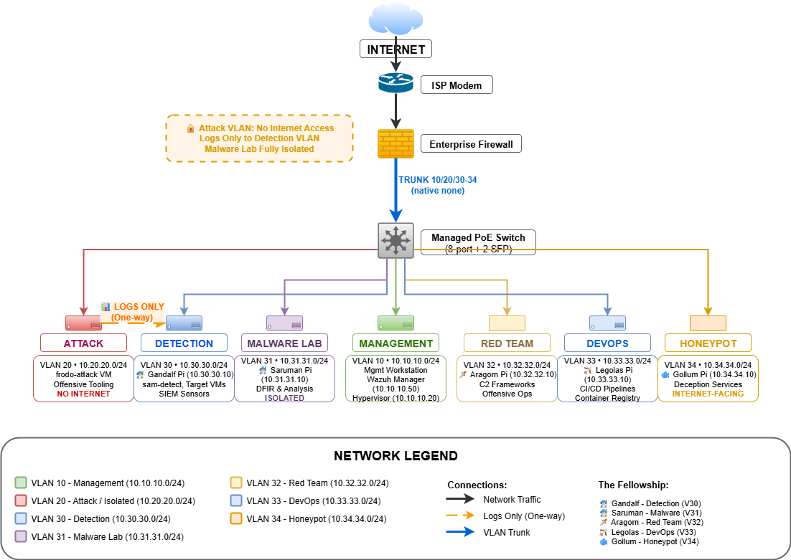

# 🛡️ Purple Lab - Enterprise SOC Infrastructure

[](https://github.com/Keith-M-work/purple-lab/actions/workflows/security-ci.yml)
[](https://github.com/Keith-M-work/purple-lab/actions/workflows/security-scan.yml)


> Production-style purple team lab with segmented VLANs, Wazuh SIEM, real attacks, and real detections.

Built and run end to end: the network segmentation, the SIEM, the attack tooling, and the detections that catch it. Detections are mapped to MITRE ATT&CK and validated in CI.

---

## ⚡ At a Glance

| Area | What's here |
|---|---|
| **Detection engineering** | **27 Sigma rules** in four difficulty tiers, plus native **Splunk, Elastic, CrowdStrike, YARA and Wazuh** versions of key techniques → [Detection Catalog](./sec-ops/detections/README.md) |
| **Detection-as-code** | Sigma and YARA validated in **GitHub Actions** on every push and PR to `main` ([workflows](./.github/workflows/)) |
| **Network security** | 7 VLANs behind an enterprise firewall, default-deny inter-VLAN rules, egress control per zone |
| **SIEM** | Wazuh single-node stack with agents across VLANs, custom rules and C2 patterns |
| **Adversary emulation** | Havoc and Sliver C2 configs, beacon simulation, attack playbooks |
| **Active Directory** | Scripted AD lab build, BloodHound setup, AD-focused detections |
| **Automation** | PowerShell lab management (Pi fleet, Wazuh deployment) and Pi bootstrap scripts |

## 🌟 Highlights

| Project | Why it's interesting |
|---|---|
| [**Session token reuse (T1550.004)**](./sec-ops/detections/specs/T1550.004_session_token_reuse.md) | Detection spec, then implementations for **Okta, Entra ID and web apps** in Sigma, Splunk, Elastic and CrowdStrike. Catches stolen-session replay that MFA doesn't stop. |
| [**Ransomware behaviour chain**](./sec-ops/detections/sigma/3-advanced/ransomware_behavior/) | Shadow-copy deletion, ransom notes, mass file changes, correlated into one chain |
| [**APT activity chain**](./sec-ops/detections/sigma/4-expert/apt_chain/) | Persistence → credential theft → lateral movement, linked across events |
| [**LSASS credential dumping (T1003.001)**](./sec-ops/detections/README.md#same-techniques-native-platforms) | Same technique implemented for four platforms |
| [**C2 frameworks**](./sec-ops/offensive/c2/) | Havoc and Sliver setups plus a [beacon simulator](./sec-ops/offensive/c2/simulations/scripts/) used to generate detection data |
| [**Wazuh across VLANs**](./medium-series/part2-wazuh-vlans/) | SIEM deployment guide with the firewall rules segmentation actually needs |
| [**IR runbook**](./sec-ops/blue-team/incident-response/runbook.md) | Incident response runbook and [template](./sec-ops/blue-team/incident-response/templates/incident-template.md) |

---

## 🏗️ What This Is

A battle-tested SOC lab featuring:
- **5 VLAN-segmented Raspberry Pis** (Fellowship-themed: Gandalf, Saruman, Aragorn, Legolas, Gollum)
- **Enterprise Firewall** with strict inter-VLAN rules
- **Type-1 Hypervisor** with attack VMs and targets
- **Wazuh SIEM** with working detection rules
- **Real vulnerable applications** and C2 frameworks
- **PowerShell automation** for Pi management

---

## 📊 Network Architecture Diagram



*Detailed technical diagram showing all 7 VLANs, firewall rules, and traffic flows. This represents the full production implementation with 5 Raspberry Pis (Fellowship members), hypervisor VMs, and enterprise-grade segmentation.*

Active Directory lab topology: [ad-lab-topology.png](./ad-lab/assets/ad-lab-topology.png) · [AD network diagram notes](./ad-lab/network-diagram.md)

---

## 🌐 Network Architecture

### VLAN Layout

| VLAN | Name | Subnet | Gateway | Purpose |
|------|------|--------|---------|---------|
| **10** | Management | 10.10.10.0/24 | 10.10.10.1 | Admin, Hypervisor, Wazuh manager |
| **20** | Attack | 10.20.20.0/24 | 10.20.20.1 | frodo-attack VM, C2 staging (no internet by default) |
| **30** | Detection | 10.30.30.0/24 | 10.30.30.1 | SIEM sensors, target VMs, Gandalf Pi |
| **31** | Malware Lab | 10.31.31.0/24 | 10.31.31.1 | Saruman Pi - malware analysis, DFIR |
| **32** | Red Team | 10.32.32.0/24 | 10.32.32.1 | Aragorn Pi - offensive tools, C2 relay |
| **33** | DevOps | 10.33.33.0/24 | 10.33.33.1 | Legolas Pi - CI/CD, container registry |
| **34** | Honeypot | 10.34.34.0/24 | 10.34.34.1 | Gollum Pi - deception services (internet-facing) |

### Physical Topology

```
┌─────────────┐
│  INTERNET   │
└─────┬───────┘
      │ (WAN)
┌─────┴──────────────────────────────────────────┐
│      Enterprise Firewall Appliance             │
│  WAN: DHCP from ISP                            │
│  LAN: 10.10.10.1/24    (VLAN 10 • Management)  │
│  OPT1: 10.20.20.1/24   (VLAN 20 • Attack)      │
│  OPT2: 10.30.30.1/24   (VLAN 30 • Detection)   │
│  OPT3: 10.31.31.1/24   (VLAN 31 • Malware)     │
│  OPT4: 10.32.32.1/24   (VLAN 32 • Red Team)    │
│  OPT5: 10.33.33.1/24   (VLAN 33 • DevOps)      │
│  OPT6: 10.34.34.1/24   (VLAN 34 • Honeypot)    │
└───────────────┬────────────────────────────────┘
                │ TRUNK (VLANs 10,20,30-34)
                │
┌───────────────┴──────────────────────────────────┐
│  Managed PoE Switch (8-port + 2 SFP)             │
│  Switch Management IP: 10.10.10.2                │
│  [Port 1]  Empty                                 │
│  [Port 2]  Management Workstation (VLAN 10)      │
│  [Port 3]  Gandalf Pi (VLAN 30) → 10.30.30.10    │
│  [Port 4]  Saruman Pi (VLAN 31) → 10.31.31.10    │
│  [Port 5]  Aragorn Pi (VLAN 32) → 10.32.32.10    │
│  [Port 6]  Legolas Pi (VLAN 33) → 10.33.33.10    │
│  [Port 7]  Gollum Pi (VLAN 34) → 10.34.34.10     │
│  [Port 8]  Legacy Router (logging/isolated)      │
│  [SFP 1]   Hypervisor Host (TRUNK) → 10.10.10.20 │
│  [SFP 2]   Firewall Trunk                        │
└──────────────────────────────────────────────────┘
```

### Key Infrastructure

**Hypervisor Host (Compact Server - 10.10.10.20)**
- VLAN-aware bridge on SFP1
- VMs:
  - `frodo-attack` (VLAN 20) → 10.20.20.50 - Offensive tooling
  - `sam-detect` (VLAN 30) → 10.30.30.50 - Detection sensor
  - `pippin-util` (VLAN 30) → 10.30.30.52 - Utilities
  - `merry-endpoint` (VLAN 30) → 10.30.30.53 - Endpoint testbed

**Management Workstation (VLAN 10 - 10.10.10.100)**
- Linux subsystem + Container runtime
- Wazuh single-node stack:
  - Manager: 10.10.10.50
  - Dashboard: `https://10.10.10.50:443`
  - Indexer: 10.10.10.50:9200
- Switch management interface
- PowerShell lab automation functions

---

## 🧙 The Fellowship (Raspberry Pis)

### 🧙‍♂️ Gandalf Pi (VLAN 30 - Detection)
**IP:** 10.30.30.10  
**Role:** Blue team sensor & log collection
- Wazuh agent (telemetry to manager)
- Log forwarding agents (syslog, file monitoring)
- Container runtime + lightweight orchestration
- Optional: Network monitoring (with mirrored traffic)

### 🧙‍♂️ Saruman Pi (VLAN 31 - Malware Analysis)
**IP:** 10.31.31.10  
**Role:** DFIR & reverse engineering
- YARA signature scanning
- Disassembly and analysis tools
- Binary inspection utilities
- Isolated malware execution environment

### 🗡️ Aragorn Pi (VLAN 32 - Red Team)
**IP:** 10.32.32.10  
**Role:** Offensive utilities & C2 relay
- Attack simulation frameworks
- Network reconnaissance tools
- Command and control redirectors
- Container runtime

### 🏹 Legolas Pi (VLAN 33 - DevOps)
**IP:** 10.33.33.10  
**Role:** CI/CD & container registry
- Container runtime and orchestration
- CI/CD pipeline runners
- Private container registry
- Security testing integration

### 🐟 Gollum Pi (VLAN 34 - Honeypot)
**IP:** 10.34.34.10  
**Role:** Internet-facing deception (WiFi-enabled)
- Low-interaction honeypot services
- Fake SSH/Telnet endpoints
- Deceptive network services
- Full internet exposure (monitored)

---

## 🔒 Security Zones & Rules

### Egress Control (Firewall)

| VLAN | Internet Access | Notes |
|------|----------------|-------|
| **10** (Management) | ✅ Full | Admin workstation, updates |
| **20** (Attack) | ❌ Blocked | Allowlist only for repos/tools |
| **30** (Detection) | ✅ Limited | Agent traffic to SIEM only |
| **31** (Malware) | ❌ Blocked | Only signature updates via proxy |
| **32** (Red Team) | ⚠️ Controlled | Allowlist for specific exercises |
| **33** (DevOps) | ✅ Limited | Registries, CI traffic only |
| **34** (Honeypot) | ✅ Full | Inbound from internet (monitored) |

### Inter-VLAN Rules

- **All VLANs → VLAN 10 (Wazuh):** Ports 1514/1515/443 allowed
- **VLAN 10 → All VLANs:** Admin SSH/RDP allowed
- **VLAN 20 → VLAN 30:** Attack to targets only during exercises
- **VLAN 31 ↔ Others:** Isolated (malware containment)
- **Default:** Deny all inter-VLAN unless explicitly allowed

---

## 📁 Repository Structure

```
purple-lab/
├── sec-ops/
│   ├── detections/        # ⭐ Sigma (by tier), Splunk, Elastic, CrowdStrike, YARA, Wazuh + CI tests
│   ├── offensive/         # C2 (Havoc, Sliver), beacon simulator, attack playbooks
│   └── blue-team/         # Incident response runbook + template
├── ad-lab/                # Active Directory lab build, BloodHound, AD topology
├── lab-apps/vuln-apps/    # Juice Shop, Flask SQLi (localhost-only, see SECURITY.md)
├── core-infra/            # Pi bootstrap, Wazuh deployment automation, sample config
├── medium-series/         # Part 1: foundation · Part 2: Wazuh across VLANs
├── training-exercises/    # Purple team exercise template
├── scripts/               # Repo setup and demo-file helpers
├── docs/                  # Troubleshooting, validation, demo playbook
├── assets/                # Network architecture diagram
└── .github/               # CI workflows, CONTRIBUTING, SECURITY policy, CODEOWNERS
```

## 📚 Documentation

- [🛠️ Critical issues we fixed](./docs/troubleshooting.md): real problems from the build and their fixes
- [🚦 Quick validation](./docs/validation.md): verify segmentation, agents and firewall rules
- [🎬 Demo playbook](./docs/demo-playbook.md)
- [Wazuh documentation](https://documentation.wazuh.com/)

---

## 🎯 Planned Enhancements

- [ ] **Full packet capture solution** for network forensics
- [ ] **Geo-blocking and threat intelligence feeds** on firewall
- [ ] **Hypervisor backup system** for VM snapshots
- [x] **Detect-as-code** CI pipeline (Sigma and YARA validation in GitHub Actions)
- [ ] **WiFi penetration testing device** integration
- [ ] **SPAN port** dedicated to packet capture
- [ ] **Agent health SLOs** (95%+ check-in rate alerts)

---

## ⚠️ Safety & Compliance

- **Never expose to public internet** (except honeypot VLAN 34)
- **Placeholder addressing:** all IPs in this repo are illustrative (RFC 1918 ranges), not the real lab's
- **Vulnerable apps** strictly isolated in designated VLANs and bound to localhost ([security policy](./.github/SECURITY.md))
- **C2 frameworks** disabled by default, activated per-exercise
- **Malware samples** encrypted at rest, air-gapped analysis

---

## 🤝 Contributing

Contributions welcome! Please see [CONTRIBUTING.md](./.github/CONTRIBUTING.md) for:
- 🐛 Bug reports
- 💡 Feature suggestions
- 📝 Documentation improvements
- 🔧 Configuration optimizations
- 🎯 New detection rules or attack scenarios

---

## ⚖️ License

MIT License - See [LICENSE](./LICENSE) for details.

---

## 💬 Connect

Built by **Keith** | Purple Team Practitioner

- 🐙 [GitHub](https://github.com/Keith-M-work) - More security projects

**If this lab helped you, please ⭐ star the repo!**

---

*Built with ❤️ for the cybersecurity community | Last updated: November 2026*
